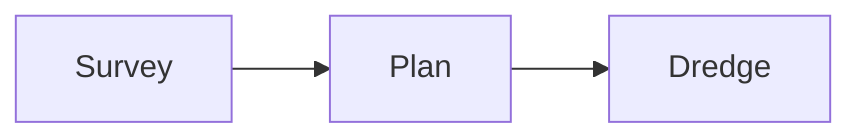

# Cheat sheet

Everything you write most often, on one page. Follow the links for the full explanation.

## Markdown

| Write                                           | Get                            |
| ----------------------------------------------- | ------------------------------ |
| `# Title`, `## Section`, `### Sub`              | Headings — each starts a block |
| `**bold**` `*italic*` `~~struck~~` `` `code` `` | Inline formatting              |
| `H<sub>2</sub>O`, `mc<sup>2</sup>`              | Subscript, superscript         |
| `[text](https://example.com)`                   | Link                           |
| ``          | Image                          |
| `- item`, `1. item`                             | Lists (indent to nest)         |
| `- [ ] to do`, `- [x] done`                     | Task list                      |
| `> quoted`                                      | Blockquote                     |
| `\| A \| B \|` + `\| --- \| --: \|`             | Table (colons align columns)   |
| `text[^1]` + `[^1]: The note.`                  | Footnote                       |
| `---`                                           | Horizontal rule                |
| `---` lines around `key: value` at the top      | [Frontmatter](frontmatter.md)  |

More in [How the format works](markup.md#markdown-you-already-know).

## Tag forms

| Form                                                | Where                  | Does                                                                  |
| --------------------------------------------------- | ---------------------- | --------------------------------------------------------------------- |
| `## Heading {[quote]}`                              | End of a heading       | Picks the block's template                                            |
| `## Heading {[quote duration=8]}`                   | End of a heading       | Template plus parameters and [settings](tags.md#block-settings)       |
| `## Heading {[duration=8]}`                         | End of a heading       | Settings only; template unchanged                                     |
| `## Heading {#id .class duration=8}`                | End of a heading       | [Attribute block](tags.md#attribute-blocks): id, class, settings      |
| `{[statHighlight stat="89%" …]}`                    | A paragraph on its own | A [heading-less block](tags.md#standalone-tags)                       |
| `{[audio src=voice.mp3]}`                           | A paragraph on its own | A [timed clip](media.md#audio-and-video-clips) (`video`, `media` too) |
| `{[github]}`, `{[fa-solid:star]}`                   | In body text           | An [inline icon](tags.md#inline-icons)                                |
| `### Box {[rectangle x=0 y=0 width=100 height=60]}` | Child of `{[drawing]}` | A shape — see [Drawing](../blocks/drawing.md)                         |

Quote values with spaces: `caption="At the quay"`. Escape `*` and `_` inside values: `\*`.
Full rules: [Parameter values](tags.md#parameter-values).

## Blocks you'll use most

| Block                                               | Heading line                                                                                    | Body                        |
| --------------------------------------------------- | ----------------------------------------------------------------------------------------------- | --------------------------- |
| [Title](../blocks/title.md)                         | `# Harbor Survey 2026 {[title subtitle="Spring season report"]}`                                | —                           |
| [Section Header](../blocks/sectionHeader.md)        | `## Part two: the plan {[sectionHeader]}`                                                       | —                           |
| [Big Text](../blocks/bigText.md)                    | `## Ready to sail {[bigText]}`                                                                  | —                           |
| [Content](../blocks/content.md)                     | `## Background {[content]}`                                                                     | Any Markdown, shown in full |
| [List](../blocks/list.md)                           | `## Agenda {[list]}`                                                                            | A list                      |
| [Quote](../blocks/quote.md)                         | `## In their words {[quote]}`                                                                   | `> The quote` and `> — Who` |
| [Stat Highlight](../blocks/statHighlight.md)        | `## Traffic {[statHighlight stat="18%" description="more boats than last spring"]}`             | —                           |
| [Fact Card](../blocks/factCard.md)                  | `## The breakwater is 1.2 km long {[factCard]}`                                                 | The explanation             |
| [Definition Card](../blocks/definitionCard.md)      | `## Breakwater {[definitionCard]}`                                                              | The definition              |
| [Two Column](../blocks/twoColumn.md)                | `## Then and now {[twoColumn left="2016\|5.1 m deep" right="2026\|4.2 m deep"]}`                | —                           |
| [Date Event](../blocks/dateEvent.md)                | `## Opening day {[dateEvent date="June 14, 2026" description="The east quay opens"]}`           | —                           |
| [Comparison Bar](../blocks/comparisonBar.md)        | `## Depth {[comparisonBar leftLabel=2016 leftValue=5.1 rightLabel=2026 rightValue=4.2 unit=m]}` | —                           |
| [Image with Caption](../blocks/imageWithCaption.md) | `## At dawn {[imageWithCaption caption="The breakwater at first light"]}`                       | One image                   |
| [Left Feature](../blocks/leftFeature.md)            | `## The new quay {[leftFeature]}`                                                               | An image and a paragraph    |
| [Photo Grid](../blocks/photoGrid.md)                | `## Around town {[photoGrid]}`                                                                  | Two to four images          |
| [Data Table](../blocks/dataTable.md)                | `## Catch {[dataTable]}`                                                                        | A table                     |
| [Column Chart](../blocks/columnChart.md)            | `## Catch {[columnChart]}`                                                                      | A table of numbers          |
| [Pie Chart](../blocks/pieChart.md)                  | `## Catch {[pieChart]}`                                                                         | A table of numbers          |
| [Map](../blocks/map.md)                             | `## Where we work {[map center="60.39,5.32" zoom=12]}`                                          | —                           |
| [Video with Caption](../blocks/videoWithCaption.md) | `## Launch day {[videoWithCaption]}`                                                            | A YouTube or Vimeo link     |

Leave the tag off and a section that's only a table, list, quote, image, or stat-like line gets a
matching design anyway — see [automatic templates](markup.md#automatic-templates).

```squisq-docs
template-list
```

## Block settings

Add these to any heading's tag. Full table: [Block settings](tags.md#block-settings).

| Setting               | Example                        | Notes                                                           |
| --------------------- | ------------------------------ | --------------------------------------------------------------- |
| `duration`            | `duration=8`, `duration=01:30` | Video mode; default is reading time                             |
| `startTime`           | `startTime=02:15`              | Pins the block on the timeline                                  |
| `transition`          | `transition=push`              | `fade`, `dissolve`, `wipe`, `zoom`, `flip`, `cube`, … or `none` |
| `transitionDirection` | `transitionDirection=left`     | `left`, `right`, `up`, `down`, …                                |
| `transitionDuration`  | `transitionDuration=1.5`       | Seconds; default 0.7                                            |
| `build`               | `build=items`                  | `items`, `branches`, `chunks`, `off`                            |
| `buildEffect`         | `buildEffect=fadeIn`           | `appear`, `fadeIn`, `fadeInUp`, `slideIn`                       |
| `buildPrevious`       | `buildPrevious=dim`            | `keep` or `dim`                                                 |
| `colorScheme`         | `colorScheme=teal`             | A parameter of many templates, not every one                    |

## Frontmatter

```yaml
---
title: Harbor Survey 2026
squisq-theme: documentary
display-mode: slideshow
squisq-cover-slide: false
squisq-auto-templates: false
---
```

| Key                       | Does                                                                                              |
| ------------------------- | ------------------------------------------------------------------------------------------------- |
| `title`, `subtitle`       | Document title and cover subtitle                                                                 |
| `squisq-theme`            | Theme id: `standard`, `documentary`, `gezellig`, …                                                |
| `display-mode`            | Editor opens in `slideshow`, `video`, `page`, `document`, `dashboard`, `flashcards`, or `narrate` |
| `document-render-as`      | `landscape`, `portrait`, `square`, or `standard`                                                  |
| `squisq-cover-slide`      | `false` hides the cover                                                                           |
| `squisq-auto-templates`   | `false` turns off automatic templates                                                             |
| `squisq-dashboard-layout` | `auto` or a layout id such as `grid-2x2`                                                          |
| `squisq-proof-dialect`    | `American`, `British`, `Australian`, `Canadian`, `Indian`                                         |

Every key: [Frontmatter](frontmatter.md).

## Picture fences

| Fence            | Draws                                          |
| ---------------- | ---------------------------------------------- |
| ` ```diagram `   | A box-and-line diagram from ASCII art          |
| ` ```tree `      | A file or outline tree                         |
| ` ```timeline `  | A timeline                                     |
| ` ```mermaid `   | A Mermaid diagram                              |
| ` ```svg `       | Your own SVG, shown as a picture               |
| ` ```json data ` | Not a picture: values for the block's template |

````markdown preview
## How the survey runs

```diagram
+--------+     +-------+
| Survey | --> | Plan  |
+--------+     +-------+
```

## What we hand over

```tree
survey/
├── depths.csv
└── report.md
```

## The season

```timeline
● March ───● June ───● October
```

## Next steps


````

Details: [Diagrams](diagrams.md) and [SVG pictures](diagrams.md#svg-pictures).
