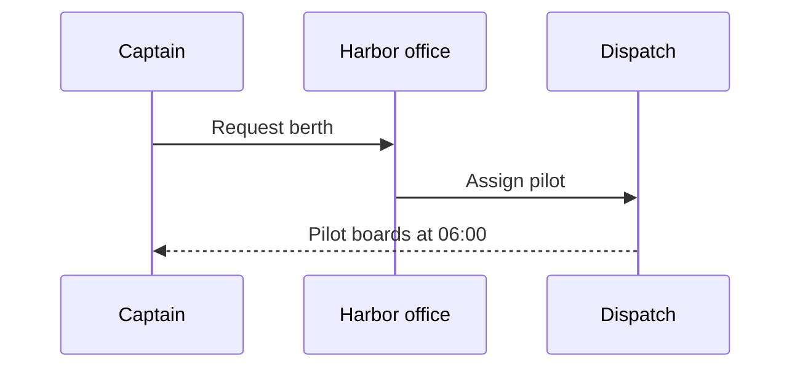

# Diagrams

Every diagram in Squiggly Square is text in a code fence. The text is the source of truth: it reads
fine in any Markdown viewer, it diffs cleanly in Git, and the editor and player draw it as a
picture. Pick the kind by the fence's language:

| Fence           | Draws                                                  | Shown through                               |
| --------------- | ------------------------------------------------------ | ------------------------------------------- |
| ` ```diagram `  | Boxes joined by lines and arrows                       | The [diagram](../blocks/diagram.md) block   |
| ` ```tree `     | File trees and outlines                                | The [tree](../blocks/tree.md) block         |
| ` ```timeline ` | Milestones along one or more horizontal lines          | The [timeline](../blocks/timeline.md) block |
| ` ```mermaid `  | Flowcharts, sequence, state, class, ER, Gantt and more | Mermaid's own renderer                      |
| ` ```svg `      | Any vector illustration                                | A sanitized image                           |

For shapes you place by coordinates instead of by drawing them in text, use a
[drawing](../blocks/drawing.md) block; to arrange other blocks on a canvas, use a
[layout](../blocks/layout.md) block.

The Write view, the Slideshow, Page, Dashboard, and Video views, and the HTML player exports draw
box diagrams, trees, and timelines. The Document view and plain-HTML exports show them as the text
art you wrote, in a code block — which is why the art should read well on its own. For Word,
PowerPoint, and PDF, see [Import and export](import-export.md).

## Box diagrams

Draw boxes with box-drawing characters, join them with lines, and point the lines with arrowheads.
Squiggly Square reads the boxes as nodes and the lines as connections:

````markdown preview
## How a survey reaches the archive {[diagram background=surface]}

```diagram
┌───────────┐            ┌───────────┐
│ Field app │── upload ─►│  Survey   │
└───────────┘            │    API    │
                         └─────┬─────┘
                               │
                               ▼
                         ┌───────────┐
                         │  Archive  │
                         └───────────┘
```
````

### What you can draw

| Element          | How to write it                                                                                                                             |
| ---------------- | ------------------------------------------------------------------------------------------------------------------------------------------- |
| Box              | Unicode light `┌─┐│└┘`, rounded `╭╮╰╯`, heavy `┏┓┗┛`, or double `╔╗╚╝` borders — or ASCII `+`, `-`, and `\|`                                |
| Label            | Text inside the box; several lines become a multi-line label                                                                                |
| Connection       | A run of `─`/`│` (or `-`/`\|`) from one box border to another                                                                               |
| Direction        | An arrowhead where the line meets a box: `► ◄ ▲ ▼`, `▶ ◀`, `→ ← ↑ ↓`, or ASCII `>` `<` `^` `v`. No arrowhead means an undirected connection |
| Connection label | Text inside a horizontal run (`── upload ──►`) or beside a vertical one (`│ nightly`)                                                       |
| Container        | A box drawn around other boxes; put its title in the top border: `┌─ Harbor office ──┐`                                                     |

The same diagram in plain ASCII works just as well:

````markdown preview
## Sensor network {[diagram background=surface]}

```diagram
+---------+       +---------+       +-----------+
| Buoy 12 |------>| Gateway |------>| Dashboard |
+---------+       +---------+       +-----------+
```
````

A container holds the boxes drawn inside it:

````markdown preview
## Who handles a berth request {[diagram background=surface]}

```diagram
┌─ Harbor office ──────────────────────┐
│  ┌──────────┐        ┌──────────┐    │
│  │ Planning │───────►│ Dispatch │    │
│  └──────────┘        └──────────┘    │
└──────────────────────────────────────┘
```
````

### Rail diagrams

Not every diagram draws boxes. In rail art the nodes are bare lines of text and the rails between
them — `|` and `v`, or a `+----+` bus — are the only structure. Squiggly Square reads each piece of
text a rail reaches as a node and draws it as a box:

````markdown preview
## Nightly tide pipeline {[diagram background=surface]}

```diagram
tide gauges
     |
     v
harbor model
     |
     v
nightly report
```
````

Text that no rail connects stays text: a list of words is not a diagram.

### Tagged and untagged fences

A ` ```diagram ` fence is always treated as a diagram, even one with a single box. Squiggly
Square also recognizes box art in a fence with no language, or tagged `text`, `txt`, `plaintext`,
`plain`, or `ascii`, but only when it is clearly a diagram:

- It has at least two boxes, or rail text that the rails connect.
- It is 3–400 lines long and at most 400 characters wide.
- It isn't a Markdown table, or a grid of touching boxes with no connections (the shape of a
  database query result).
- No more than a quarter of its characters are loose text outside the boxes and lines.
- Its labels aren't garbled (see [Repairing broken art](#repairing-broken-art)).

A fence tagged with any other language (`js`, `html`, `xml`) is always code. When you want to show
box art as code, give it one of those tags.

A section becomes a diagram slide automatically when its body is that one fence, with no table,
image, or video beside it and at most a few sentences of prose. You can also tag the heading
`` `{[diagram]}` `` yourself, which lets you add settings. The examples on this page use
`background=surface`, which paints the theme's surface behind the diagram; without it the diagram
has no background of its own. The [diagram block](../blocks/diagram.md) lists its other
settings, such as node shapes and edge styles.

### Editing on the canvas

In the Write view, a diagram fence becomes a canvas. The fence stays in the document, and every
change you make on the canvas rewrites its art:

- **Select** a box to drag it or resize it; double-click it to rename it.
- **Connect** draws a connection: drag from one box to another.
- **Node** adds a box, and **Delete** removes the selected one.
- **Arrange** re-places every box so the connections flow from top to bottom.
- **Source** shows or hides the ASCII art beneath the canvas, where you can edit it directly.
- Drag the bottom edge to make the canvas taller; double-click it to reset.

The first canvas edit tags an untagged fence ` ```diagram `, so it stays a diagram later.
Fences you don't touch keep their exact bytes. **Insert → Diagram** adds a starter diagram, and
pasting box art into the Write view creates a ` ```diagram ` fence for you.

### Repairing broken art

Hand-drawn art sometimes falls apart: labels outgrow their boxes and push the borders out of line
from row to row. When that happens Squiggly Square leaves the fence as a code block rather than draw
a garbled picture, and the Write view shows a banner beneath it — "This looks like a diagram that
didn't render cleanly." Click **Repair as diagram** to re-trace the boxes, recover the labels, and
rewrite the fence as clean ` ```diagram ` art in one undoable step.

## Trees

A tree fence draws a file tree or an outline. Write it the way `tree` prints a folder, or the way an
AI assistant sketches a project:

````markdown preview
## Survey repository

```tree
harbor-survey/
├── README.md
├── data/
│   ├── soundings.csv      # depth readings
│   └── tides.csv
└── report/
    └── findings.md        <-- start here
```
````

| Element     | How to write it                                                                                         |
| ----------- | ------------------------------------------------------------------------------------------------------- |
| Branches    | `├──` and `└──` with `│` rails, or ASCII `\|--`, `` `-- ``, and `+--`                                   |
| Folder      | A trailing `/` (`data/`), or any item with children                                                     |
| Comment     | `#`, `<--`, or `//` after **two or more** spaces. With one space it is part of the name (`C# bindings`) |
| Indentation | Depth comes from where each name starts, so ragged art still nests correctly                            |

A ` ```tree ` fence can also be plain indentation, with no connector characters at all:

````markdown preview
## Launch plan

```tree
Launch plan
  Research
    Interviews
    Field survey
  Build
  Ship
```
````

An untagged (or `text`) fence is recognized as a tree only when it has at least two connector
lines (`├──`, `└──`) and no box corners — a fence with box corners belongs to the box-diagram
reader. Under a heading tagged `` `{[tree]}` ``, a nested bullet list draws as a tree too.

In the player, folders collapse and expand when you click them. In the Write view the fence becomes
an outline editor:

- **Add file** and **Add folder** add items; each row also has **Add child**, **Indent**,
  **Outdent**, **Move up**, **Move down**, and **Delete** buttons, and a drag handle.
- Type to rename an item. **Enter** adds a sibling below, **Tab** and **Shift+Tab** indent and
  outdent, and **Backspace** in an empty name deletes the item.
- The icon button switches an item between file and folder, and the chevron collapses a folder.

Each change rewrites the fence. **Insert → Tree** adds a starter tree, and pasting tree art creates
a ` ```tree ` fence. To edit the text itself, use the Source view.

## Timelines

A timeline fence draws events along a horizontal line. Put a dot on the line for each event and
write its label inline after the dot:

````markdown preview
## Harbor survey

```timeline
Survey: ● Scoping {#scope} ──────● Field work {#field} ──────● Report :: Published to the council {#report} ───►
```
````

Or write the labels above the line, lined up with their dots:

````markdown preview
## Product launch

```timeline
          Kickoff       Beta          Launch
──────────●─────────────●─────────────●──────────► 2026
```
````

| Element     | How to write it                                                                                                    |
| ----------- | ------------------------------------------------------------------------------------------------------------------ |
| Line        | A run of `─` (or `━ ═ ┄`, or ASCII `-`), optionally ending in an arrow `►` `▶` `→` `>` and an end label            |
| Event       | A marker on the line: `●` `•` `◉` (filled), `○` (hollow), `◆` `◇` (diamond); ASCII `*`, `o`, `O`                   |
| Track name  | Text and a colon before the line: `Survey: ●──…`                                                                   |
| Label       | Text after the marker, or text above or below the line in the marker's column                                      |
| Description | `Label :: longer text` puts the longer text in the event's callout                                                 |
| Settings    | Braces at the end of the event's text: `{#id side=above}`. See the table below                                     |
| Pointer     | `▲` or `▼` (ASCII `^`, `v`) in a row above or below the line marks a point between events, with its label after it |
| Branch      | A line of its own: `branch: tooling -> beta : firmware freeze` (`link:` also works; `->`, `=>`, or `→`)            |

The settings an event accepts:

| Setting                           | Effect                                                                        |
| --------------------------------- | ----------------------------------------------------------------------------- |
| `#id`                             | A stable id, used by `branch:` lines                                          |
| `side=above` / `below`            | Which side of the line the label sits on (inline labels alternate by default) |
| `descriptionSide=above` / `below` | Where the description sits, when it differs from the label                    |
| `callout=false`                   | A plain tick with no callout                                                  |
| `column=N`                        | The event's position on the shared scale                                      |

Write several lines in one fence and they share one horizontal scale, so events in the same column
line up. A branch joins an event on one track to an event on another:

````markdown preview
## Device program

```timeline
Hardware: ● Prototype {#proto} ──────────● Tooling {#tooling} ──────────►
Software: ● Alpha {#alpha} ──────────● Beta {#beta} ──────────►
branch: tooling -> beta : firmware freeze
```
````

An untagged fence is recognized as a timeline only when it has at least two Unicode markers
(`●`, `○`, `◆`, …) on a line at least eight characters long, and no boxes. Tag the fence
` ```timeline ` to use ASCII markers (`*---o--->`) or a single event.

In the Write view the fence becomes a timeline editor. Click an event to edit its label, callout
text, label side, and marker, to hide its callout, or to delete it; use the **+** beside a line to add an event
where you click; use **Add line** to add a track. Each change rewrites the fence in one undoable
step. **Insert → Timeline** adds a starter, and pasting marker art creates a ` ```timeline `
fence.

## Mermaid

For diagrams the ASCII readers can't express — sequence diagrams, state machines, class and ER
diagrams, Gantt charts, mind maps — write a ` ```mermaid ` fence. Squiggly Square hands it to
[Mermaid](https://mermaid.js.org/) unchanged, so every diagram type Mermaid supports works:

````markdown
## Berth request


````

`accTitle` gives the diagram an accessible name, which a PowerPoint export also uses as the
picture's name. Mermaid runs at its strict security level, so `click` directives in the source do
nothing.

Where a Mermaid fence draws:

| Where                                                 | Result                                                                                        |
| ----------------------------------------------------- | --------------------------------------------------------------------------------------------- |
| The Write view                                        | The diagram, with a canvas for editing                                                        |
| Slideshow, Page, Dashboard, and Video views           | The diagram                                                                                   |
| DOCX, PDF, and PPTX exported from the editor          | A picture of the diagram                                                                      |
| Single-file HTML and HTML zip exports (player styles) | A "could not render" notice: the player embedded in the file leaves Mermaid out to stay small |
| The Document view, plain HTML, and EPUB               | The source, as a code block                                                                   |
| DOCX, PDF, and PPTX from the [command line](cli.md)   | The source as text: the command line has no browser to draw it with                           |

The same small player draws the live examples in these docs, which is why this page shows Mermaid
as code only.

In the Write view, **Insert → Complex Diagram (Mermaid)** asks which diagram type to start from.
**Source** opens the fence text under a live preview. For flowcharts and many other diagram types
you can also work on the canvas — add a node, **Connect** two, change a node's **Shape**,
**Duplicate** or **Disconnect**, switch a flowchart's **Direction**, and edit **Properties**. Every
gesture rewrites a small piece of the source; anything a gesture can't express, edit in **Source**.
Right-drag pans the canvas and Ctrl/⌘ + wheel zooms.

## SVG pictures

A ` ```svg ` fence draws its SVG as a picture — an "SVG island":

````markdown preview
## Channel marker

The red can buoy marks the port side of the channel.

```svg
<svg viewBox="0 0 240 160" xmlns="http://www.w3.org/2000/svg">
  <title>Channel marker buoy</title>
  <rect width="240" height="160" fill="#dbeafe"/>
  <path d="M0 118 Q30 108 60 118 T120 118 T180 118 T240 118 V160 H0 Z" fill="#2563eb"/>
  <path d="M104 118 L112 52 H128 L136 118 Z" fill="#dc2626"/>
  <rect x="110" y="70" width="20" height="10" fill="#ffffff"/>
  <circle cx="120" cy="44" r="8" fill="#facc15"/>
</svg>
```
````

The language is what makes the picture: an `xml`, `html`, or untagged fence with the same markup
stays code, which is how you show SVG source to a reader.

### What's allowed

Squiggly Square never shows your markup as written. It parses the fence, keeps only safe parts, and
shows the cleaned copy as an image, where no script runs and nothing is fetched. What it keeps:

- One `<svg>` root. Anything beside it rejects the whole fence.
- Shapes, paths, text, groups, `<use>`, gradients, patterns, masks, clip paths, markers, filters,
  `<style>`, `<title>`, `<desc>`, and SMIL animation (`<animate>`, `<animateTransform>`,
  `<animateMotion>`, `<set>`).
- References inside the island only: `href="#id"`, `url(#id)`, and embedded raster `data:` images
  in `<image>`.
- `currentColor`, which follows the color of the text around the picture.

What it removes:

- `<script>`, `<foreignObject>`, and any HTML element, with everything inside them. An `<a>` is
  unwrapped, keeping its contents.
- Event handlers such as `onload`, and any attribute it doesn't recognize.
- Links to anything outside the island: absolute URLs, `@import`, `@font-face`, and CSS functions
  that fetch.

A fence over 512 KB, more than 20,000 elements, or nested deeper than 200 levels doesn't draw. In
the Write view the picture has a **Source** action that opens the markup under a live preview and
lists what the sanitizer removed. A fence that can't draw shows its source and the reason. Pasting a
lone SVG document into the Write view creates a ` ```svg ` fence.

Animations play in the editor and the player. Exported video and images (MP4, GIF, PNG) show a
still, and an animation that ends with `fill="freeze"` shows its end state.

### Attached SVG files

An `.svg` file used as an image — `` — goes through the same sanitizer,
so the file as written never reaches a page or an export either. Attached SVGs keep their own
colors. A remote `https://…/logo.svg` image is shown from its own address. See
[Images](media.md#images).

### In exports

| Format        | An SVG island becomes                                                             |
| ------------- | --------------------------------------------------------------------------------- |
| HTML          | An image of the cleaned SVG                                                       |
| EPUB          | An SVG image file in the book                                                     |
| DOCX and PPTX | Native vector art, with a PNG fallback for older readers                          |
| PDF           | A picture when exported from the editor; the source as code from the command line |

See [Import and export](import-export.md) for everything else each format keeps.
